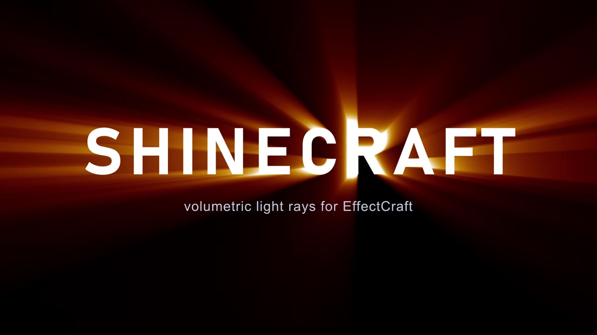

# ShineCraft

[](media/shinecraft_demo.mp4)

▶ [Watch the feature demo](media/shinecraft_demo.mp4) (68 s, 1080p): every scene rendered in EffectCraft 0.24.1 with the
native helper.

Volumetric light rays for [EffectCraft](https://github.com/storytold/effectcraft): light streams out
of the bright parts of a layer, away from a source point, with shimmer, gradient colorize and
fractal noise.

One effect (id `io.github.spoofah.shinecraft`, category Stylize), shipped two ways from the same
code (`shine()` in `src/lib.rs`), with the same parameters and the same look:

| | File | Speed (1080p frame) | Install |
|---|---|---|---|
| WebAssembly plug-in | `shinecraft.wasm` | ~1 s (sandboxed interpreter) | Plug-in Library, or the `Plug-ins` folder |
| Native effect helper (Windows x64, Linux x64) | `effectcraft-helper-shinecraft(.exe)` | ~13 ms on all cores | EffectCraft's `helpers` folder |

Use the helper for real work; the plug-in is for the Plug-in Library and other systems.
Install only one of them: if the `.wasm` is loaded, EffectCraft won't register the helper's
effect, which has the same id.

## Install

Downloads are on the [releases page](https://github.com/spoofah/shinecraft/releases).

**Native helper (fast, Windows and Linux):**
1. Close EffectCraft.
2. Copy `effectcraft-helper-shinecraft.exe` (Windows) or `effectcraft-helper-shinecraft` (Linux)
   into the `helpers` folder beside the EffectCraft program (or into a folder named in the
   environment variable `EFFECTCRAFT_HELPER_PATH`). On Linux, make it executable:
   `chmod +x effectcraft-helper-shinecraft`. The Linux build renders the same frames as the
   Windows one in EffectCraft's command-line renderer on Ubuntu (under WSL); the Linux desktop
   app hasn't been tried yet.
3. Start EffectCraft and run Effect ▸ Scan for Effect Helpers (or start it with the environment
   variable `EFFECTCRAFT_HELPERS=1`). ShineCraft is then in Effects & Presets ▸ Stylize.

**WebAssembly plug-in:** Settings ▸ Plug-in Library ▸ ShineCraft ▸ Install, once it is listed
there. Or close EffectCraft, put `shinecraft.wasm` in the `Plug-ins` folder of the settings
folder (`%APPDATA%\EffectCraft`, or `EffectCraftData` beside a portable copy) and start it again.

Needs EffectCraft 0.23.0 or later; tested on 0.24.1 and 0.25.1.

## Controls

- **Pre-Process:** Threshold, Use Mask, Mask Radius, Mask Feather.
- **Source Point** and **Ray Length**.
- **Shimmer:** Amount, Detail, Source Point affects Shimmer, Radius, Reduce Flickering, Phase,
  Use Loop, Revolutions in Loop.
- **Boost Light.**
- **Colorize:** None, One Color, 3-Color or 5-Color Gradient, Base On (Lightness, Luminance,
  Alpha, Alpha Edges, Red, Green, Blue), Edge Thickness and the colours.
- **Fractal Noise:** speed, evolution, brightness, contrast, opacity, size, complexity, detail, rotation,
  an optional noise mask, and its blend (Add, Multiply, Screen, Lighten).
- **Source Opacity**, **Shine Opacity** and **Blend Mode** (14 modes).
- **Extend Past Layer** (off by default): pads the layer so rays can leave it, where the host
  supports padding.

On hosts that support parameter groups the controls fold into twirl-downs; elsewhere they are one
flat list.

## Build

The Rust version is pinned in `rust-toolchain.toml`.

```sh
cargo test --release --locked
cargo build --release --locked --target wasm32-unknown-unknown
cargo build --release --locked --features helper --bin effectcraft-helper-shinecraft
```

The plug-in is `target/wasm32-unknown-unknown/release/shinecraft.wasm` and imports nothing; the
helper is `target/release/effectcraft-helper-shinecraft(.exe)`. Releases are built from the tag by
`.github/workflows/release.yml`.

## How it works

1. Emission per pixel (Base On, threshold, mask): at full resolution in the helper, box-averaged
   onto a 480 px working grid in WebAssembly.
2. A radial blur toward the source: rays one working pixel apart, each a running sum in polar
   coordinates with an exact exponential falloff, landing on the working grid (960 px in the
   helper).
3. Shimmer, boost, per-pixel fractal noise and colorize.
4. Bilinear upsample and the transfer mode.

## Licence

MIT or Apache-2.0, at your choice (`LICENSE-MIT`, `LICENSE-APACHE`).
